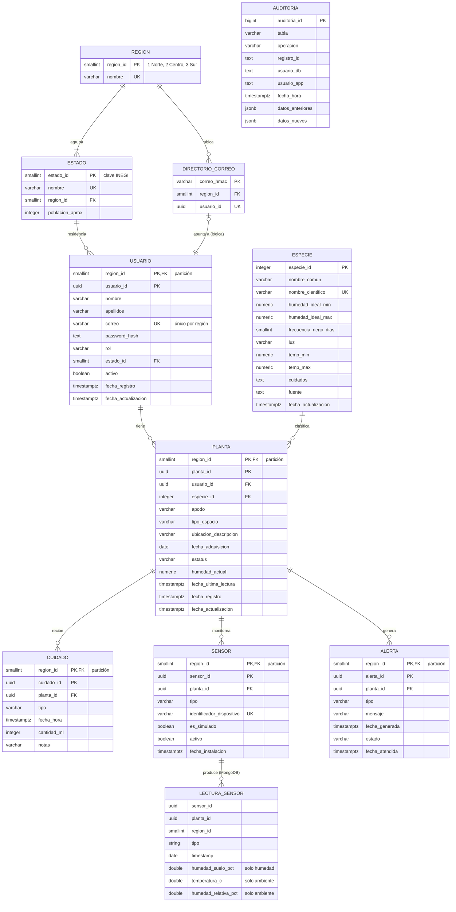

# A2 · Modelo entidad-relación y normalización

Responsable: Alexa Yalee Sánchez Tejeda · Última revisión: 2026-11-26
IA: asistido (Claude), revisado por la responsable. Ver `docs/bitacora-ia.md`.

El modelo tiene 9 tablas en PostgreSQL y 1 colección en MongoDB. Todas las tablas cumplen la tercera forma normal (3FN), con una sola excepción a propósito: la columna `region_id` en las tablas fragmentadas. Esa excepción la exige la fragmentación, y las llaves compuestas impiden que el dato quede inconsistente (sección 3).

## 1. Diagrama

GitHub dibuja este diagrama automáticamente al abrir el archivo. La misma imagen está en `docs/datos/modelo-er.png`.

AUDITORIA no tiene relaciones: guarda una copia de los cambios de cualquier tabla, identificados con `tabla` y `registro_id`.

## 2. Relaciones y cardinalidades

| Relación | Cardinalidad | Cómo se implementa | Al borrar el padre |
|---|---|---|---|
| Región – Estado | 1 a muchos (cada región tiene al menos un estado) | estado.region_id → region | No se borra (catálogo fijo) |
| Estado – Usuario | 1 a muchos | FK compuesta (region_id, estado_id) → estado | No se permite |
| Usuario – Planta | 1 a muchos | FK compuesta (region_id, usuario_id) → usuario | Se borran sus plantas (CASCADE) |
| Especie – Planta | 1 a muchos | planta.especie_id → especie | No se permite (RESTRICT) |
| Planta – Cuidado / Sensor / Alerta | 1 a muchos | FK compuesta (region_id, planta_id) → planta | CASCADE |
| Directorio – Usuario | 1 a 1 | Lógica: `usuario_id` UNIQUE. No hay FK porque el usuario puede estar en otro nodo | La API borra la entrada del directorio |
| Sensor – LecturaSensor | 1 a muchos | Lógica: MongoDB no tiene llaves foráneas; la API valida el sensor_id | Las lecturas expiran solas (A15) |

## 3. Justificación de la tercera forma normal

**Primera forma normal (1FN).** Todos los atributos son atómicos: no hay listas dentro de una celda ni grupos repetidos. Los cuidados, sensores y alertas de una planta van en tablas aparte, una fila por elemento. Las dos lecturas del sensor ambiente (temperatura y humedad relativa) son campos separados.

**Segunda forma normal (2FN).** Las tablas con llave compuesta son las fragmentadas, con llave (region_id, X_id). Ningún atributo depende solo de una parte de la llave:
- X_id es un UUID, único por sí mismo. Todos los atributos dependen de él.
- `region_id` no determina ningún otro atributo de la fila.

**Tercera forma normal (3FN).** No debe haber dependencias transitivas, es decir, atributos que dependan de otro atributo que no es llave.

| Tabla | Dependencias funcionales principales | ¿3FN? |
|---|---|---|
| region | region_id → nombre | Sí |
| estado | estado_id → nombre, region_id, poblacion_aprox | Sí |
| especie | especie_id → todos sus atributos | Sí. `nombre_cientifico` también es llave candidata (UNIQUE) |
| directorio_correo | correo_hmac → region_id, usuario_id | Sí. `usuario_id` es llave candidata |
| usuario | usuario_id → nombre, apellidos, correo, password_hash, rol, estado_id, activo, fechas | **Excepción controlada**: usuario_id → estado_id → region_id |
| planta | planta_id → usuario_id, especie_id, apodo, tipo_espacio, …, humedad_actual | **Excepción controlada**: planta_id → usuario_id → region_id |
| cuidado, sensor, alerta | X_id → planta_id y sus atributos | **Excepción controlada**: X_id → planta_id → region_id |
| auditoria | auditoria_id → todos sus atributos | Sí |

Lo que se separó para cumplir la 3FN:
- **Los datos de la especie** (humedad ideal, frecuencia de riego, luz, temperatura) viven solo en `especie`. Si estuvieran en `planta`, se repetirían en cada planta de la misma especie y habría que actualizarlos en miles de filas.
- **El nombre del estado y su región** viven en `estado`. El usuario solo guarda `estado_id`.
- **El nombre de la región** vive en `region`. Las demás tablas solo guardan el número.

### 3.1 La excepción: `region_id` en las tablas fragmentadas

`region_id` se puede deducir:
- en `usuario`, a partir de `estado_id`;
- en las demás tablas fragmentadas, a partir de la planta o del usuario.

En teoría es una dependencia transitiva que rompe la 3FN. Se deja **a propósito** por tres razones:

1. **PostgreSQL lo exige.** Una tabla `PARTITION BY LIST` necesita que la columna de partición esté en la propia tabla, y que esté incluida en la llave primaria y en todo UNIQUE.
2. **Coloca los datos juntos.** Todas las filas de un usuario (plantas, cuidados, sensores, alertas) quedan en el mismo nodo, y las consultas Q2 a Q6 no salen de él.
3. **Evita JOIN entre nodos.** Para saber en qué partición buscar un cuidado no hace falta consultar antes la planta ni el usuario.

El riesgo de una desnormalización es que el dato repetido quede inconsistente. Aquí eso **no puede pasar**, porque las llaves foráneas son compuestas:
- `(region_id, estado_id) → estado` impide registrar a un usuario de Jalisco en la región Centro.
- `(region_id, usuario_id) → usuario` impide que una planta quede en una región distinta a la de su dueño.
- `(region_id, planta_id) → planta` hace lo mismo para cuidados, sensores y alertas.

La prueba 03 y la prueba 09 de `db/tests/a3_pruebas_esquema.sql` demuestran que la base rechaza esos casos.

### 3.2 Otros datos que se guardan a propósito

| Dato | Por qué no rompe el modelo |
|---|---|
| planta.humedad_actual, fecha_ultima_lectura | Es una copia de la última lectura de MongoDB. Se guarda porque PostgreSQL no puede consultar MongoDB (trigger de A6 y Q10). El histórico completo sigue en MongoDB. |
| region_id y planta_id dentro de lectura_sensor | En MongoDB no hay JOIN: se repiten para filtrar por planta y por región sin consultar PostgreSQL. Se escriben una vez y no cambian. |
| usuario.correo y directorio_correo.correo_hmac | No es el mismo dato: el directorio guarda un HMAC, no el correo. Hace falta porque usuario está fragmentado y el directorio es global. |

### 3.3 Cambio de región de un usuario

Si un usuario se muda a un estado de otra región, su `region_id` cambia y todas sus filas tienen que pasar al otro nodo. Se considera un caso raro. La operación se define en A9, junto con la fragmentación.
